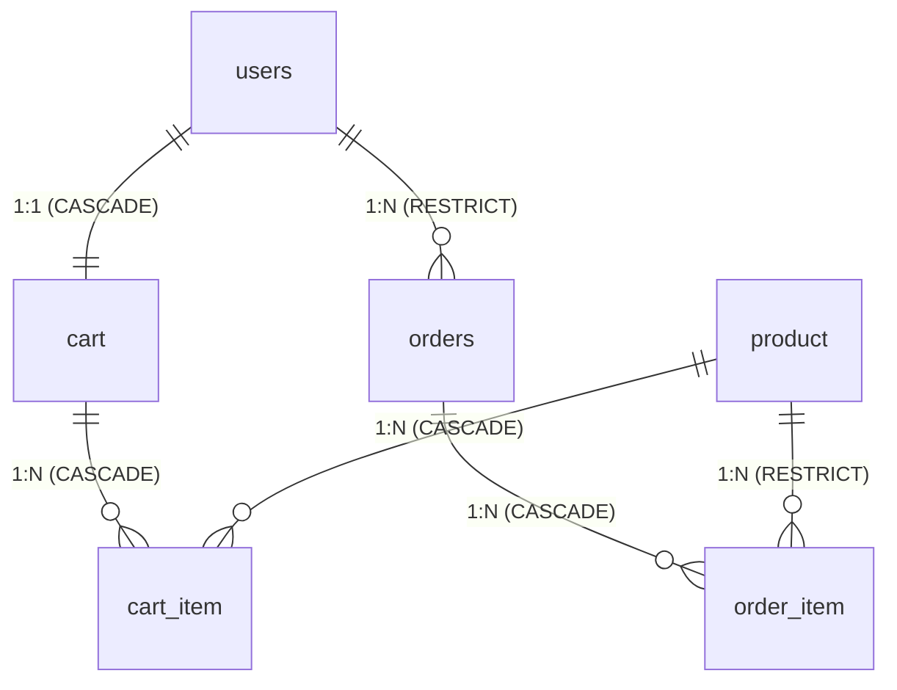

# 고기서고기 (MEAT-To-MEAT)

> **대학생을 위한 정육 전문 온라인 쇼핑몰 설계 및 구현**  
> 2026년 2학기 **데이터베이스 설계** (담당: 서영정 교수님) 최종 팀 프로젝트 (**확장형 A/B**)

- **팀 구성**: **강현찬** (팀장 · PM) · **김민준** (BE) · **최한음** (BE)
- **GitHub 저장소**: `https://github.com/potatostore/MEAT-To-MEAT`
- **제출일**: 2026년 11월 29일

---

## 1. 프로젝트 개요

온라인 농축수산물 거래가 빠르게 증가하는 가운데, 기존 온라인 정육 서비스는 프리미엄·초신선 중심으로 형성되어 가격 부담이 큽니다. **고기서고기(MEAT-To-MEAT)**는 대학생이 저렴하고 양 많은 고기를 부위별로 비교해 주문할 수 있는 정육 전문 온라인 쇼핑몰로, 다음 세 가지 목표에 집중해 설계·구현·검증했습니다.

1. **데이터 정합성 중심의 RDBMS 설계**: 3NF 정규화 6개 테이블, `order_item.order_price` 단가 스냅샷, `PK·FK·UNIQUE·CHECK` 제약 및 `CASCADE`/`RESTRICT` 삭제 규칙을 **MySQL 8.4 (InnoDB)**와 **Flyway (`V1`~`V3`, `ddl-auto=validate`)**로 강제
2. **대량 데이터(주문 10만 건) 기반 측정 · SQL 튜닝**: 재귀 CTE([db/bench/bulk-data.sql](./db/bench/bulk-data.sql))로 생성한 회원 2,003명 · 상품 30,020개 · 주문 약 10만 건 환경에서 **k6 + Prometheus + Loki + Grafana**로 병목을 관측하고, N+1 조회 · 상품 삭제 풀 스캔 · 정렬 비용 · 동시 주문 데드락/Lost Update를 정량 개선
3. **확장형 B — 관리자용 NL2SQL 자연어 질의**: **FastAPI + Groq LLM**과 관리자 웹 콘솔(`/admin/ask`)을 통해 한국어 질문을 SQL로 변환·읽기 전용으로 안전 실행하며, 기본 스키마(`Simple`)와 키·코드·업무 용어 보강(`Rich`) 프롬프트를 비교 평가하는 체계 구축

---

## 2. 최종 제출 방식 및 결과물 구성

소스 코드 중심 파일은 본 GitHub 저장소에 관리하고, 최종 결과보고서 및 발표 자료는 LMS에 압축 제출합니다.

| 제출 항목 | 제공 위치 | 내용 |
|---|---|---|
| **1) 설계 및 구현 결과물 (소스코드)** | GitHub 저장소 | 본 저장소 전체 (`backend/`, `frontend/`, `db/`, `nl2sql/`, `monitoring/`, `loadtest/`, `docker-compose.yml`) |
| **2) 최종 결과보고서** | LMS 압축 제출 | `고기서고기(MEAT-To-MEAT): 대학생을 위한 정육 전문 온라인 쇼핑몰 설계 및 구현` (1. 서론 ~ 7. 참고문헌) |
| **3) 발표용 파일 (10~15분)** | LMS 압축 제출 | 수업시간 발표용 슬라이드 파일 |
| **4) 부하 테스트 실측 원본 자료** | GitHub 저장소 | [loadtest/results/api-compare.md](./loadtest/results/api-compare.md) 및 `loadtest/results/{before,after,compare}/` |

---

## 3. 시스템 아키텍처 및 기술 스택

3계층 웹 애플리케이션(`Next.js` → `/api` 프록시 → `Spring Boot` → `MySQL 8.4`)을 중심으로, 관리자용 `NL2SQL` 서비스(`/nl2sql` 프록시 → `FastAPI` → `Groq LLM` / `nl2sql_reader`)와 `Prometheus · Loki · Alloy · Grafana · k6` 관측·부하 스택을 **Docker Compose 프로필(`full`, `nl2sql`, `monitoring`, `loadtest`)**로 분리 구성했습니다.

```mermaid
flowchart LR
    USER["쇼핑몰 사용자 (Browser)"] --> FE["Next.js 16 Frontend (:3000)"]
    FE -->|/api 프록시| BE["Spring Boot 3.3 Backend (:8080)"]
    FE -->|/nl2sql 프록시 (/admin/ask)| NL["FastAPI NL2SQL (:8000)"]
    K6["k6 부하 테스트"] -->|HTTP 부하| BE
    BE -->|JPA / Flyway| DB[("MySQL 8.4 InnoDB (:3306)")]

    NL -->|Simple / Rich Prompt| LLM["Groq LLM (openai/gpt-oss-120b)"]
    NL -->|nl2sql_reader SELECT 전용| DB

    BE -->|/actuator/prometheus| PROM["Prometheus (:9090)"]
    K6 -->|Remote Write| PROM
    BE -->|컨테이너 로그| ALLOY["Grafana Alloy (:12345)"]
    DB -->|slow.log >= 0.1s| ALLOY
    ALLOY -->|Log Push| LOKI["Grafana Loki (:3100)"]
    PROM --> GRAF["Grafana 대시보드 (:3001)"]
    LOKI --> GRAF
```

| 구성 요소 | 적용 기술 | 역할 | 포트 |
|---|---|---|---|
| **프론트엔드** | Next.js 16.3, React 19, TypeScript 5, Tailwind CSS 4 | 쇼핑몰 화면(17개 페이지 포함 `/admin/ask`), 백엔드·NL2SQL 요청 프록시 | `3000` |
| **백엔드** | Java 17, Spring Boot 3.3.11, Spring Security, JPA (Hibernate 6.5), Flyway 9, jjwt 0.12.6 | 24개 REST API, JWT 인증(유효 24시간), 비즈니스 로직 | `8080` |
| **데이터베이스** | MySQL 8.4 LTS (InnoDB, `utf8mb4_unicode_ci`) | 6개 핵심 테이블 저장, 슬로우 쿼리 로그(`>= 0.1s`) | `3306` |
| **NL2SQL (확장)** | Python 3.12, FastAPI, Uvicorn, PyMySQL, `cryptography`, Groq API (`openai/gpt-oss-120b`) | 자연어 질문을 SQL로 변환·읽기 전용 실행 (관리자 전용) | `8000` |
| **모니터링** | Spring Actuator, Micrometer, Prometheus 3.5, Loki 3.5, Alloy 1.10, Grafana 12.1 | API 지표·Hibernate SQL 통계·에러/슬로우 로그 통합 대시보드 | `9090`, `3100`, `12345`, `3001` |
| **부하 테스트** | k6 1.2 | 전 API 24종 호출 및 동시 주문 경합 시나리오 부하 생성 | — |
| **협업 · CI** | Docker Compose, GitHub (브랜치·PR), GitHub Actions | 프로필별 원클릭 실행, Docker 스모크 테스트 자동화 | — |

> **기술 선택 근거 (RDBMS & MySQL 8.4)**  
> 주문 생성은 재고 차감 + 주문/주문상품 생성 + 장바구니 정리가 단일 트랜잭션으로 묶이는 ACID 업무이며, FK·CHECK 제약과 다중 테이블 조인·집계(NL2SQL 포함)가 필수입니다. MySQL 8.4는 `CHECK` 제약 실제 검사(8.0.16+), 재귀 CTE, `EXPLAIN ANALYZE`, InnoDB 클러스터 인덱스(PK 동점 정렬 활용), `SELECT ... FOR UPDATE`를 모두 지원해 본 프로젝트에 가장 적합했습니다.

---

## 4. 데이터베이스 설계 (ERD · 정규화 · 제약조건)

3NF 정규화를 거쳐 **회원(`users`), 상품(`product`), 장바구니(`cart`), 장바구니 내 상품(`cart_item`), 주문(`orders`), 주문 상품(`order_item`)** 6개 테이블로 설계했으며, 모든 테이블에 공통 컬럼(`create_at`, `update_at`)을 두고 `orders.create_at`을 주문 일시로 사용합니다.



| 테이블 | 주요 제약조건 및 설계 의도 |
|---|---|
| `users` | `PK(user_id)`, `UQ(login_id, email, phone_number)`, `CHECK(sex IN ('M','F','NONE'))`, 비밀번호 BCrypt 해시 |
| `product` | `PK(product_id)`, `UQ(product_name)`, `CHECK(product_price >= 1, stock_quantity >= 0)`, **V3 복합 인덱스 5종** |
| `cart` | `PK(cart_id)`, `FK/UQ(user_id → users, ON DELETE CASCADE)` — 회원 1:1 장바구니 자동 생성 |
| `cart_item` | `PK(cart_item_id)`, `UQ(cart_id, product_id)`, `CHECK(quantity >= 1)`, `ON DELETE CASCADE` — 동일 상품 수량 합산 |
| `orders` | `PK(order_id)`, `FK(user_id → users, ON DELETE RESTRICT)`, `CHECK(order_status 5종)`, `idx_orders_user_created(user_id, create_at)` |
| `order_item` | `PK(order_item_id)`, `FK(order_id CASCADE, product_id RESTRICT)`, **`order_price` 주문 당시 단가 스냅샷 저장** |

- **Flyway 마이그레이션** (`spring.jpa.hibernate.ddl-auto=validate`):
  - [V1__init_schema.sql](./backend/m2m-shoppingmall-api/src/main/resources/db/migration/V1__init_schema.sql) — 6개 테이블 DDL 및 제약조건
  - [V2__insert_mock_data.sql](./backend/m2m-shoppingmall-api/src/main/resources/db/migration/V2__insert_mock_data.sql) — 개발·시연용 목데이터 (회원 3명, 상품·장바구니항목·주문·주문상품 각 20건)
  - [V3__add_product_list_indexes.sql](./backend/m2m-shoppingmall-api/src/main/resources/db/migration/V3__add_product_list_indexes.sql) — 상품 목록 복합 인덱스 5종 추가 및 중복 단일 인덱스 `idx_product_category` 제거

---

## 5. 주요 기능 및 REST API 명세 (5개 영역 · 24개 API + NL2SQL)

> 상품 조회, 카테고리 조회, 회원가입·로그인은 비로그인 접근이 가능하며, 나머지 API는 JWT 인증이 필요합니다.

| 영역 | 기능 ID | API 엔드포인트 | 주요 내용 |
|---|---|---|---|
| **회원** | `MEM-01~03` | `POST /auth/signup`, `/auth/login`, `/auth/logout` | 중복 확인, BCrypt 해싱, JWT 발급(유효 24시간) |
| | `MEM-04~06` | `GET, PATCH, DELETE /members/me`, `PATCH /members/me/password` | 내 정보 조회·수정·탈퇴(장바구니 연동 삭제), 비밀번호 변경 |
| **장바구니** | `CART-01, 03, 05` | *(가입 시 자동 생성)*, `GET, DELETE /cart` | 회원 1:1 장바구니 조회 및 비우기 |
| | `CART-02, 04, 06` | `POST /cart/items`, `PATCH, DELETE /cart/items/{id}` | 동일 상품 수량 합산, 재고 범위 내 수량 변경·삭제 |
| **상품** | `PROD-02, 03, 06, 07` | `GET /categories`, `GET /products`, `GET /products/{id}` | 4개 카테고리(한우·돼지고기·닭고기·수입육), 검색·정렬·페이징, 상세 |
| | `PROD-01, 04, 05` | `POST /products`, `PATCH, DELETE /products/{id}` | 등록·수정·삭제(해당 상품 장바구니 항목 일괄 삭제) |
| **주문** | `ORD-01~06` | `POST, GET /orders`, `GET, PATCH, DELETE /orders/{id}`, `POST /orders/{id}/cancel` | 선택 상품 주문(`FOR UPDATE` 재고 차감·단가 스냅샷), 최신순 목록, 배송 5단계 관리, 취소 시 재고 복구 |
| **NL2SQL (확장)** | `확장형 B` | `POST /ask`, `GET /me`, `GET /samples`, `GET /health` (`:8000`) | 지정 관리자 아이디(`NL2SQL_ADMIN_LOGIN_IDS`) 전용 자연어→SQL 변환·실행 (`/admin/ask`) |

---

## 6. 실행 방법 (Docker Compose)

### 6.1 환경변수 설정
```bash
cp .env.example .env
```
[.env.example](./.env.example)을 복사한 `.env` 파일에서 MySQL 비밀번호를 변경하고, NL2SQL 기능을 사용할 경우 `GROQ_API_KEY`([console.groq.com](https://console.groq.com)) 및 필요 시 `NL2SQL_ADMIN_LOGIN_IDS`(기본값 `meatlover`)를 설정합니다. *(`.env`는 `.gitignore`에 포함되어 있습니다.)*

### 6.2 프로필별 실행 명령
```bash
# 1) DB + 백엔드 + 프론트엔드 전체 실행
docker compose --profile full up -d --build

# 2) 쇼핑몰 + NL2SQL 관리자 질의 함께 실행 (→ http://localhost:3000/admin/ask)
docker compose --profile full --profile nl2sql up -d --build

# 3) 쇼핑몰 + 모니터링 스택(Prometheus · Loki · Alloy · Grafana) 실행
docker compose --profile full --profile monitoring up -d --build

# 4) k6 부하 테스트 실행 (Grafana에서 실시간 확인)
docker compose --profile loadtest run --rm k6 run /scripts/all-apis.js
docker compose --profile loadtest run --rm k6 run /scripts/products.js
docker compose --profile loadtest run --rm k6 run /scripts/orders.js
docker compose --profile loadtest run --rm k6 run -e PRODUCT_ID=2 -e USERS=30 /scripts/stock-race.js

# 5) NL2SQL 15문항 자동 평가 실행 (Simple vs 보강)
docker compose --profile nl2sql run --rm nl2sql python evaluate.py
```

- **기본 목데이터 테스트 계정** (`V2__insert_mock_data.sql`, 비밀번호 공통: `test1234`):
  - `meatlover` (김고기 — 기본 NL2SQL 관리자 계정) · `porkfan` (이한돈) · `chickenrun` (박닭살)
- **주요 접속 주소**:
  - 쇼핑몰 웹: `http://localhost:3000` (관리자 NL2SQL 콘솔: `http://localhost:3000/admin/ask`)
  - 백엔드 API: `http://localhost:8080` (`/actuator/health`, `/actuator/prometheus`)
  - NL2SQL Swagger: `http://127.0.0.1:8000/docs`
  - Grafana 대시보드: `http://localhost:3001` (익명 조회 가능, 편집 `admin` / `admin`)
- **프론트엔드 단독 목데이터 모드**: `.env`에서 `NEXT_PUBLIC_API_MOCK=true` 설정 시 백엔드 없이 V2와 동일한 목데이터로 화면 확인 가능
- **DB 초기화 (`V1 + V2` 복원)**: `docker compose --profile full --profile monitoring --profile nl2sql down -v` 후 재기동

---

## 7. 성능 평가 및 SQL 튜닝 결과 (보고서 5장)

재귀 CTE와 고정 공식([db/bench/bulk-data.sql](./db/bench/bulk-data.sql))으로 생성한 **회원 2,003명 · 상품 30,020개 · 주문 약 10만 건 · 주문 상품 약 20만 건** 환경에서 24개 API 전체 부하(`all-apis.js`) 및 동시 주문(재고 18개, 30명, `stock-race.js`) 시나리오를 측정·개선했습니다. *(단일 머신 자원 공유 환경이므로 절대 처리량보다 동일 조건 전후 상대 개선율로 비교)*

### 7.1 4대 병목 진단 및 개선 요약

| 문제 | 원인 | 적용한 SQL 튜닝 | 개선 결과 |
|---|---|---|---|
| **주문 목록 N+1** | 주문마다 주문 상품·상품 개별 조회 | `hibernate.default_batch_fetch_size=100` (IN 배치 조회) | 요청당 SQL **151개 → 3개** |
| **상품 삭제 지연** | 전체 장바구니 불러와 메모리 순회 | 해당 상품 `cart_item` 단일 일괄 `DELETE` | 요청당 SQL **2,007개 → 5개** |
| **상품 목록 정렬 비용** | Full Scan + `Using filesort` | V3 복합 인덱스 5종 + 동점 PK 정렬 방향 통일 | 전체 최신순 **17.3ms → 1.06ms** |
| **동시 주문 데드락 · 재고 오차** | Lost Update + `order_item` FK S-Lock과 `product` X-Lock 충돌 | `product_id` 오름차순 `SELECT ... FOR UPDATE` 선점 | **재고 불일치 0건 · 데드락 0건** *(전: 5건 성공·3개 차감·23건 데드락 → 후: 18/18 정상, 12건 정상 거절)* |

### 7.2 상품 목록 `EXPLAIN ANALYZE` 전후 비교 (상품 30,020개)

| 조회 쿼리 | 튜닝 전 실행 계획 | 전 | 튜닝 후 실행 계획 (V3) | 후 |
|---|---|---:|---|---:|
| 전체 최신순 | 테이블 전체 스캔 30,020행 + 정렬 | 17.3 ms | `idx_product_created` 역순 스캔 12행 | **1.06 ms** |
| 카테고리 최신순 | 카테고리 인덱스 7,505행 + 정렬 | 6.1 ms | `idx_product_category_created` 역순 12행 | **0.89 ms** |
| 카테고리 가격순 | 카테고리 인덱스 7,505행 + 정렬 | 6.04 ms | `idx_product_category_price` 12행 | **0.37 ms** |
| 상품명 검색 | 전체 스캔 + `LIKE` + 정렬 | 11.0 ms | `idx_product_created` 역순 스캔 중 12행 탐색 시 중단 | **2.94 ms** |

### 7.3 24개 API 통합 부하 테스트 주요 결과 (22개 API p95 감소 · 5xx 완전 해소)

> 전체 24개 API 비교표 및 Grafana 패널 비교 이미지는 [loadtest/results/api-compare.md](./loadtest/results/api-compare.md)와 `loadtest/results/`에서 확인할 수 있습니다.

| API | 평균 (전 → 후, ms) | p95 (전 → 후, ms) | p95 변화 | 5xx (전 → 후) |
|---|---:|---:|---:|---:|
| `DELETE /products/{productId}` | 463.9 → **10.6** | 685.6 → **26.0** | **-96%** | 0 → 0 |
| `GET /orders` | 82.1 → **10.8** | 155.9 → **22.0** | **-86%** | 0 → 0 |
| `DELETE /cart/items/{cartItemId}` | 9.2 → **4.8** | 30.4 → **10.8** | **-64%** | 0 → 0 |
| `GET /products` | 24.1 → **14.1** | 60.7 → **32.8** | **-46%** | 0 → 0 |
| `GET /cart` | 5.2 → **3.6** | 12.7 → **7.2** | **-43%** | 0 → 0 |
| `POST /orders` | 10.6 → **8.8** | 30.2 → **22.1** | **-27%** | **70 → 0** |
| `POST /auth/login` | 105.9 → **92.7** | 169.4 → **124.5** | **-27%** | 0 → 0 |
| `PATCH /products/{productId}` | 5.9 → **5.8** | 15.0 → **18.5** | `+23%` *(인덱스 쓰기 비용)* | 0 → 0 |

---

## 8. 확장형 B: 관리자용 NL2SQL 서비스

관리자가 쇼핑몰 웹(`/admin/ask`) 또는 FastAPI(`/docs`)에서 자연어로 질문하면 LLM이 MySQL 8 SQL을 생성하고, 안전 검증을 통과한 조회문만 실행해 **생성 SQL과 결과 표를 함께 반환**합니다.

### 8.1 다중 보안 및 대용량 안전장치
- **관리자 접근 통제**: `NL2SQL_ADMIN_LOGIN_IDS`에 등록된 회원 아이디(기본 `meatlover`)의 JWT를 백엔드 `GET /members/me`로 검증 후 허용, 서버 포트는 `127.0.0.1:8000` 로컬 바인딩
- **DB 최소 권한**: `SELECT` 전용 계정([db/init/01_nl2sql_reader.sql](./db/init/01_nl2sql_reader.sql)) + 세션 `TRANSACTION READ ONLY`
- **SQL 정적 검증**: 단일 `SELECT`/`WITH` 문만 허용(`;` 다중 쿼리 차단), 18개 변경·DDL·파일 키워드 차단, SQL 미추출 거절 응답은 DB 전달 전 차단
- **개인정보 3중 차단**: 프롬프트 스키마 제외 + SQL 문자열 검사 + 실행 결과 컬럼명(`cur.description`) 검사로 `user_pw`·`phone_number`(`SELECT *` 포함) 원천 차단
- **화면/평가 리소스 분리**: 화면 조회(`POST /ask`)는 **5초 · 최대 500행**(`LIMIT 501` + `SSCursor` 스트리밍 + `truncated` 표시), 배치 평가(`evaluate.py`)는 정확한 비교를 위해 **30초 · 행 제한 없음**으로 분리

### 8.2 프롬프트 비교 평가 설계 (`nl2sql/evaluate.py`)
- **비교 방식**: 동일한 출력 규칙 아래 **Simple**(테이블·컬럼명만 제공) vs **보강(Rich)**(PK/FK 관계, ENUM 코드값, 단가 스냅샷 및 매출·VIP·효자상품·품절임박 등 업무 용어 정의 포함)
- **평가 문항**: Level 1(단일 테이블 5문항) · Level 2(JOIN/GROUP BY/서브쿼리 5문항) · Level 3(업무 규칙·용어 해석 5문항) 총 **15문항**에 대해 실제 DB 실행 결과 일치 여부로 자동 판정
- *(NL2SQL 평가 결과 수치 및 상세 CSV는 최종 평가 실행 후 추후 기입 예정입니다.)*

---

## 9. 디렉터리 구조

```text
MEAT-To-MEAT/
├── backend/m2m-shoppingmall-api/   # Spring Boot 3.3 (controller, service, repository, entity, dto, global, Flyway V1~V3)
├── frontend/                       # Next.js 16 (app 17개 화면 포함 /admin/ask, lib/api)
├── db/
│   ├── init/01_nl2sql_reader.sql   # NL2SQL 전용 SELECT 계정 생성
│   └── bench/bulk-data.sql         # 재귀 CTE 대량 벤치마크 데이터 (회원 2,003 · 상품 30,020 · 주문 ~10만)
├── nl2sql/                         # FastAPI NL2SQL (server, llm, prompts, db, questions, evaluate)
├── monitoring/                     # Prometheus · Loki · Alloy · Grafana 대시보드 (상세: monitoring/README.md)
├── loadtest/                       # k6 시나리오(all-apis, products, orders, stock-race) 및 전후 실측 결과(results/)
├── .github/workflows/              # GitHub Actions Docker 스모크 테스트
├── docker-compose.yml              # 4개 프로필(full, nl2sql, monitoring, loadtest)
├── .env.example                    # 환경변수 템플릿
└── README.md                       # 프로젝트 안내 문서
```

---

## 10. 향후 과제 (보고서 6장)

1. **관리자 권한 분리**: 현재 `users` 테이블에 역할(`ROLE`) 컬럼이 없어 일반 로그인 회원도 상품 CRUD·주문 상태 변경 호출 가능(NL2SQL만 아이디 목록으로 확인) → 역할 컬럼 도입 및 인가 분리
2. **상품명 검색 고도화**: `LIKE '%검색어%'` 한계 보완을 위한 MySQL `ngram` 전문 검색 인덱스 검토
3. **범위 외 커머스 기능 확장**: 실제 결제 연동, 환불·교환 관리, 상품 이미지 저장 설계 추가
4. **측정 환경 분리**: 부하 발생기(k6)와 애플리케이션/DB 서버를 분리해 절대 처리량(TPS) 측정
5. **NL2SQL 고도화**: 오답 유형 기반 업무 용어 정의 보강 및 질의 결과 표·차트 시각화 확장

---

## 11. 참고 문서

- 모니터링 · 부하 테스트 상세 가이드: [monitoring/README.md](./monitoring/README.md)
- 24개 API 튜닝 전후 비교 원본표: [loadtest/results/api-compare.md](./loadtest/results/api-compare.md)
