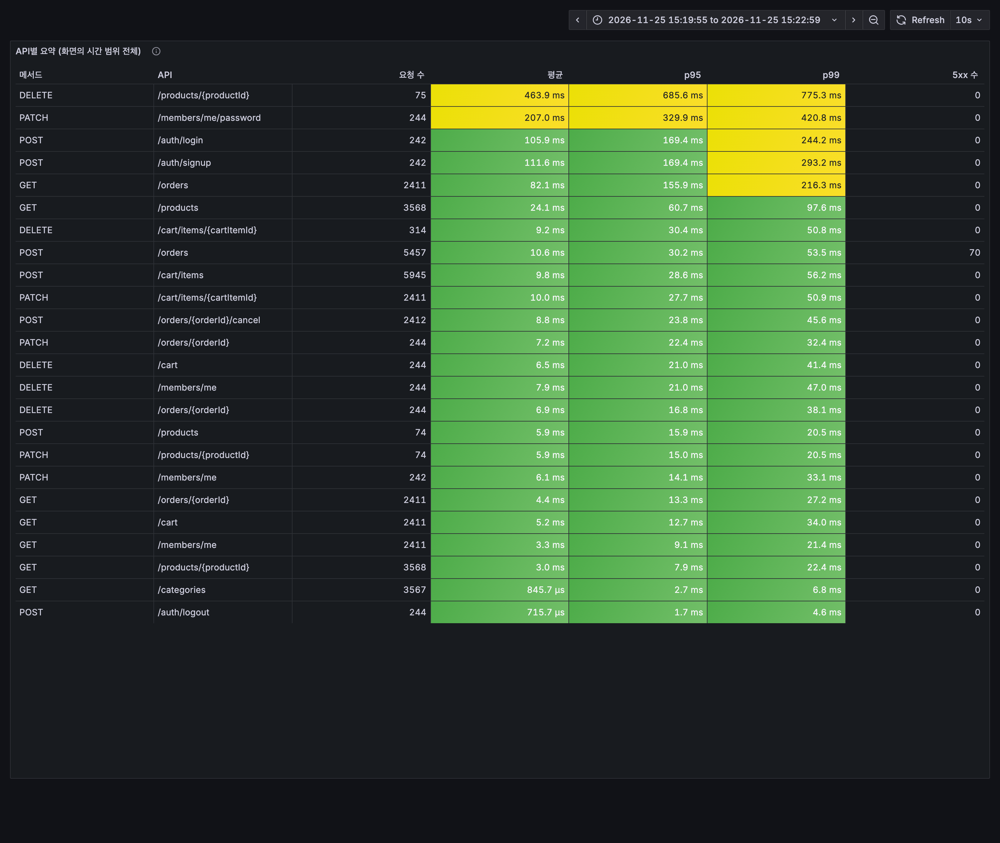
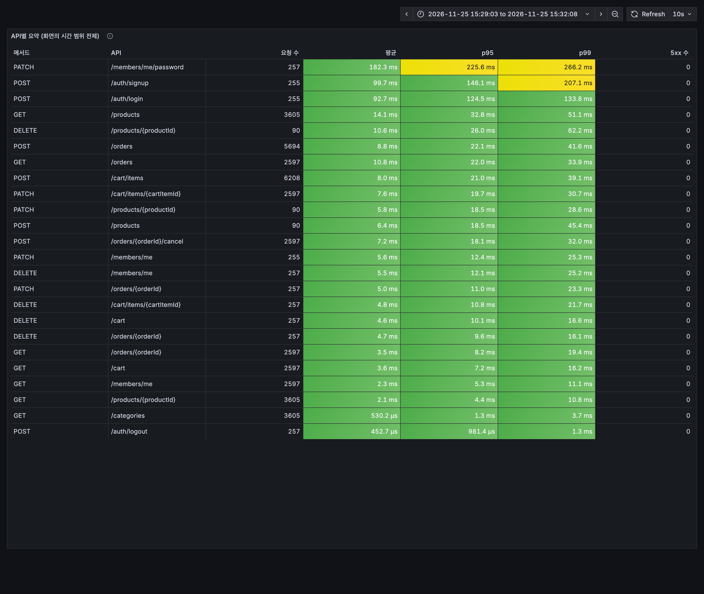
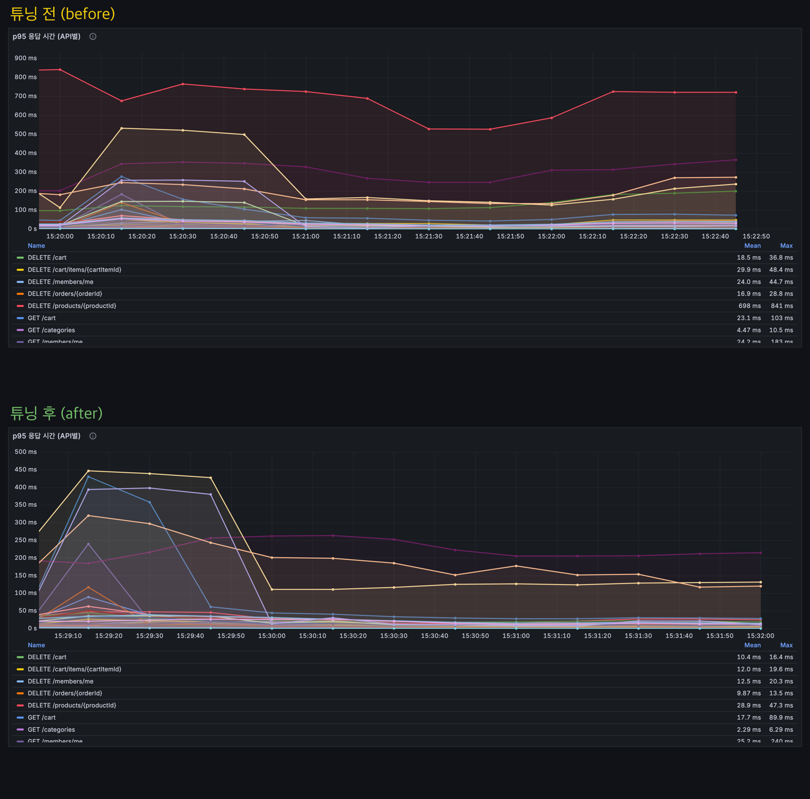
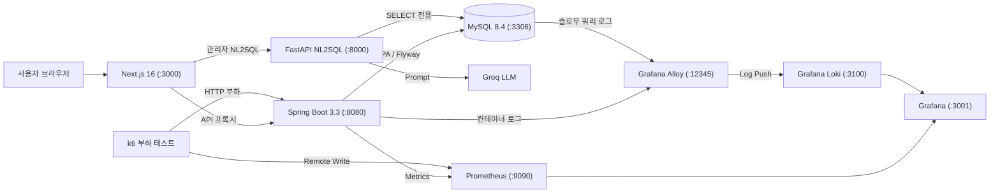

# 고기서고기 (MEAT-To-MEAT)

> 대학생이 값싼 고기를 부위별로 비교해 주문할 수 있는 정육 전문 온라인 쇼핑몰입니다.  
> **MySQL 8.4 + Spring Boot 3.3 + Next.js 16** 기반의 커머스 서비스에 **관측·부하 테스트(k6 · Grafana · Loki)**를 통한 SQL 튜닝과 **관리자용 NL2SQL(FastAPI + Groq LLM)** 기능을 함께 구현했습니다.

---

## 1. 주요 기능 및 실행화면

### 주요 기능 (5개 영역 · 24개 REST API + 확장형 B NL2SQL)

| 영역 | 주요 기능 |
|---|---|
| **회원 (`MEM-01~06`)** | 아이디·이메일·휴대폰 중복 확인 회원가입(BCrypt 해싱), JWT 로그인(유효 24시간)·로그아웃, 내 정보 조회·수정·탈퇴(장바구니 연동 삭제), 비밀번호 변경 |
| **장바구니 (`CART-01~06`)** | 회원가입 시 회원 1:1 장바구니 자동 생성, 조회·비우기, 상품 담기(동일 상품 한 줄 합산), 재고 범위 내 수량 변경 및 항목 삭제 |
| **상품 (`PROD-01~07`)** | 4개 카테고리(한우·돼지고기·닭고기·수입육), 카테고리 필터·상품명 검색·최신순/가격순/이름순 정렬·페이징 조회, 상품 상세, 등록·수정·삭제(해당 상품 장바구니 항목 일괄 삭제) |
| **주문 (`ORD-01~06`)** | 장바구니 선택 상품 주문(재고 차감·주문 당시 단가 `order_price` 스냅샷 저장), 최신순 주문 목록·상세, 배송 5단계(`주문 접수 → 배송 준비 → 배송 중 → 배송 완료`, `주문 취소`) 관리, 취소 시 재고 복구, 주문 삭제 |
| **관리자 자연어 질의 (`/admin/ask`)** | 지정 관리자 아이디(`meatlover` 등) 전용 NL2SQL 콘솔 — 한국어 질문을 SQL로 변환해 읽기 전용 실행, Simple·보강 프롬프트 생성 SQL과 결과 표 비교 |

> *상품·카테고리 조회 및 회원가입·로그인은 비로그인 접근이 가능하며, 나머지 API는 JWT 인증이 필요합니다. 환불·교환 관리 및 실제 결제 수단 연동은 구현 범위에서 제외했습니다.*

### 실행화면

- **쇼핑몰 웹 UI (`http://localhost:3000`)**: 메인, 상품 목록·검색, 상품 상세, 장바구니, 주문서·주문 완료, 마이페이지 주문·배송 조회·상세, 로그인·회원가입, 관리자 자연어 질의(`/admin/ask`) 등 **17개 화면** 제공 *(백엔드 없이 화면만 확인하려면 `.env`에서 `NEXT_PUBLIC_API_MOCK=true` 설정)*
- **관측 · 부하 테스트 대시보드 (`http://localhost:3001`, Grafana)**: 24개 API 통합 부하(`all-apis.js`) 튜닝 전/후 실측 결과

<details open>
<summary><b>Grafana API별 트래픽 요약 (튜닝 전 vs 튜닝 후) 및 p95 비교 화면</b></summary>

| 튜닝 전 (API별 요약) | 튜닝 후 (API별 요약) |
|---|---|
|  |  |



</details>

---

## 2. 시스템 구조 · 기술 스택 · 사전 요구사항



### 기술 스택

| 구성 요소 | 적용 기술 | 포트 | 역할 |
|---|---|---:|---|
| **Frontend** | Next.js 16.3, React 19, TypeScript 5, Tailwind CSS 4 | `3000` | 쇼핑몰 UI(17개 화면) 및 백엔드·NL2SQL 요청 프록시 |
| **Backend** | Java 17, Spring Boot 3.3.11, Spring Security, JPA (Hibernate 6.5), Flyway 9, jjwt 0.12.6 | `8080` | 24개 REST API, JWT 인증, 스키마 마이그레이션(`V1`~`V3`) |
| **Database** | MySQL 8.4 LTS (InnoDB, `utf8mb4_unicode_ci`) | `3306` | 6개 핵심 테이블 저장, 슬로우 쿼리 로그(`>= 0.1s`) |
| **NL2SQL** | Python 3.12, FastAPI, Uvicorn, PyMySQL, `cryptography`, Groq API (`openai/gpt-oss-120b`) | `8000` | 자연어 → SQL 변환 및 읽기 전용 실행 (로컬 전용) |
| **Monitoring · Load** | Spring Actuator, Micrometer, Prometheus 3.5, Loki 3.5, Alloy 1.10, Grafana 12.1, k6 1.2 | `3001` | 실시간 지표·로그 통합 대시보드 및 부하 테스트 |
| **Infra · CI** | Docker, Docker Compose (프로필 분리), GitHub Actions | — | 원클릭 실행 및 Docker 스모크 테스트 자동화 |

### 사전 요구사항 (Prerequisites)

- **필수 (Docker 실행 시)**: Docker 및 Docker Compose ([Docker Desktop](https://www.docker.com/products/docker-desktop/) 권장)
  - 권장 리소스: 모니터링 스택(`--profile monitoring`) 포함 전체 실행 시 Docker 메모리 약 **2~3GB** 여유 필요
- **포트 확보**: `3000`(웹), `8080`(백엔드), `3306`(MySQL), `8000`(NL2SQL), `3001`(Grafana), `9090`(Prometheus), `3100`(Loki), `12345`(Alloy)
- **NL2SQL 사용 시**: `GROQ_API_KEY` ([console.groq.com](https://console.groq.com)에서 무료 발급)
- **Docker 없이 개별 모듈 직접 개발 시**: Java 17 (Gradle), Node.js 20+, Python 3.12+

---

## 3. 설치 및 실행 방법 (Quick Start)

### Step 1. 저장소 클론 및 환경변수 준비
```bash
git clone https://github.com/potatostore/MEAT-To-MEAT.git
cd MEAT-To-MEAT
cp .env.example .env
```
- [.env.example](./.env.example)을 복사한 `.env`에서 DB 비밀번호를 변경합니다.
- NL2SQL 기능을 사용할 경우 `.env`에 `GROQ_API_KEY`와 필요 시 `NL2SQL_ADMIN_LOGIN_IDS`(기본값 `meatlover`)를 설정합니다. *(`.env`는 `.gitignore`에 포함되어 있습니다.)*

### Step 2. 목적에 맞는 Docker Compose 프로필 실행
```bash
# 1) 쇼핑몰 기본 실행 (MySQL + Backend + Frontend)
docker compose --profile full up -d --build

# 2) 쇼핑몰 + NL2SQL 관리자 질의 함께 실행
docker compose --profile full --profile nl2sql up -d --build

# 3) 쇼핑몰 + 모니터링 스택(Grafana · Prometheus · Loki · Alloy) 실행
docker compose --profile full --profile monitoring up -d --build
```

### Step 3. 브라우저 접속 및 테스트 계정 로그인

| 화면 | 주소 | 참고 |
|---|---|---|
| **쇼핑몰 웹** | http://localhost:3000 | 목데이터 단독 모드는 `.env`에 `NEXT_PUBLIC_API_MOCK=true` |
| **관리자 NL2SQL 콘솔** | http://localhost:3000/admin/ask | 지정 관리자 아이디(`meatlover`)로 로그인 후 사용 |
| **NL2SQL API 문서** | http://127.0.0.1:8000/docs | FastAPI Swagger UI (`POST /ask`, `GET /samples`, `GET /me`) |
| **Grafana 대시보드** | http://localhost:3001 | 익명 조회 가능 (대시보드 편집: `admin` / `admin`) |

- **기본 목데이터 계정** (`V2` 자동 생성, 비밀번호 공통 `test1234`): `meatlover`(김고기), `porkfan`(이한돈), `chickenrun`(박닭살)

### 부하 테스트 · 벤치마크 데이터 · 평가 · 초기화 명령
```bash
# 대량 벤치마크 데이터 적재 (회원 2,003 · 상품 30,020 · 주문 ~10만 건 · 주문 상품 ~20만 건)
docker exec -i m2m-mysql sh -c 'mysql -uroot -p"$MYSQL_ROOT_PASSWORD" meat_to_meat' < db/bench/bulk-data.sql

# k6 부하 테스트 (전 API 24종 / 상품 / 주문 / 동시 주문 정합성)
docker compose --profile loadtest run --rm k6 run /scripts/all-apis.js
docker compose --profile loadtest run --rm k6 run /scripts/products.js
docker compose --profile loadtest run --rm k6 run /scripts/orders.js
docker compose --profile loadtest run --rm k6 run -e PRODUCT_ID=2 -e USERS=30 /scripts/stock-race.js

# NL2SQL 15문항 자동 평가 실행 (Simple vs 보강 프롬프트 비교)
docker compose --profile nl2sql run --rm nl2sql python evaluate.py

# DB 및 볼륨 완전 초기화 (V1 + V2 초기 목데이터 상태로 복구)
docker compose --profile full --profile monitoring --profile nl2sql down -v
```

---

## 4. 문제 해결 과정 (Troubleshooting & Engineering Thought Process)

목데이터(상품 20개)에서는 보이지 않던 병목이 **회원 2,003명 · 상품 30,020개 · 주문 약 10만 건**을 적재하고 24개 API 전체 부하(`all-apis.js`)와 동시 주문(`stock-race.js`)을 실행하자 드러났습니다. 각 문제를 어떤 근거와 사고과정으로 해결했는지 정리합니다. *(단일 머신 자원 공유 환경이므로 절대 처리량보다 동일 조건 전후 상대 개선율로 비교했습니다.)*

### 문제 1. 주문 목록 조회 시 SQL 폭증 (`GET /orders`)
- **현상**: 부하 테스트 중 앱 CPU·JVM 메모리는 여유로웠지만 `GET /orders` p95가 `155.9ms`로 치솟고 요청 1건당 SQL이 **`151개`** 실행됨.
- **사고과정**: 서버 연산이 아닌 DB 왕복 횟수가 병목이라 판단하고 Hibernate 통계를 확인하니 `Order → OrderItem → Product` 지연 로딩으로 **N+1 문제**가 발생 중이었음. `Fetch Join`은 1:N 다중 컬렉션 조인이나 페이징 확장 시 제약이 크므로, 기존 쿼리 구조를 유지하면서 전역 지연 로딩을 최대 100개씩 `IN (...)` 절로 묶는 `hibernate.default_batch_fetch_size=100`을 채택함.
- **결과**: 요청당 SQL **`151개 → 3개`**, `GET /orders` p95 **`155.9ms → 22.0ms (-86%)`**.

### 문제 2. 상품 1개 삭제에 463.9ms 지연 (`DELETE /products/{productId}`)
- **현상**: 24개 API 중 상품 삭제가 평균 `463.9ms` / p95 `685.6ms`로 가장 느렸고, 요청 1건당 SQL이 **`2,007개`** 실행됨.
- **사고과정**: 실행된 SQL 수(`2,007개`)가 당시 전체 회원 수(`2,003명`)와 거의 일치한다는 점에 주목해 `O(N)` 순회 로직을 의심함. 코드를 추적한 결과 `ProductService.deleteProduct()`가 `cartRepository.findAll()`로 전체 회원의 장바구니를 메모리에 불러와 순회 삭제하고 있었음. 장바구니 조회 자체를 제거하고 `cart_item.product_id` FK 인덱스를 타는 단일 일괄 `DELETE` 쿼리(`O(1)`)로 교체함.
- **결과**: 요청당 SQL **`2,007개 → 5개`**, 평균 **`463.9ms → 10.6ms`**, p95 **`685.6ms → 26.0ms (-96%)`**.

### 문제 3. 상품 목록 정렬 시 Full Scan & `Using filesort` (`GET /products`)
- **현상**: 상품 30,020건 기준 목록 정렬 쿼리를 `EXPLAIN ANALYZE`로 확인하자 테이블 전체 스캔(30,020행) 또는 카테고리 전체(7,505행)를 읽은 뒤 매번 정렬(`filesort`)이 수행됨(`17.3ms`).
- **사고과정**: 기존 단일 인덱스 `idx_product_category`만으로는 정렬을 생략할 수 없었고, `price_asc`는 `(product_price ASC, product_id DESC)` 혼합 정렬이라 B-Tree 인덱스를 그대로 탈 수 없었음. 이에 `(WHERE 조건, ORDER BY 컬럼, 동점 PK)` 순서의 **복합 인덱스 5종([V3](./backend/m2m-shoppingmall-api/src/main/resources/db/migration/V3__add_product_list_indexes.sql))**을 생성하고, 선행 컬럼이 겹치는 기존 `idx_product_category`는 `DROP`해 쓰기 오버헤드를 줄임. 동시에 동점 정렬 방향을 통일해 MySQL 8 **Backward Index Scan**으로 오름·내림차순 모두 `LIMIT 12`행만 읽고 즉시 종료하게 함.
- **결과**: 전체 최신순 **`17.3ms → 1.06ms`**, 카테고리 최신순 **`6.1ms → 0.89ms`**, 카테고리 가격순 **`6.04ms → 0.37ms`**, 상품명 검색 **`11.0ms → 2.94ms`**, `GET /products` p95 **`60.7ms → 32.8ms (-46%)`**. *(트레이드오프: 인덱스 추가에 따른 쓰기 갱신 비용으로 `POST /products` `+16%`, `PATCH /products/{id}` `+23%` 소폭 증가했으나 모두 20ms 미만이고 조회 비중이 압도적이라 허용)*

### 문제 4. 동시 주문 시 데드락(5xx 70건) 및 재고 불일치 (`POST /orders`)
- **현상**: 재고 18개 상품에 30명이 동시에 주문하자 **5건이 성공했는데 재고는 3개만 차감(2건 누락)**되었고, 실패 25건 중 **23건이 데드락**으로 실패함. 24개 API 통합 부하에서도 `POST /orders`에서 5xx 에러가 **70건** 발생함.
- **사고과정**: 스키마에 `CHECK (stock_quantity >= 0)` 제약만 두어서는 동시 트랜잭션 충돌을 막을 수 없음을 확인함. Loki 에러 로그(`Deadlock found when trying to get lock`)와 쿼리 순서를 추적한 결과 두 원인이 겹쳐 있었음.
  1. 락 없는 스냅샷을 동시에 읽고 차감해 덮어쓰는 **Lost Update**
  2. `INSERT INTO order_item`이 FK 검증용으로 `product` 행에 공유 락(S-Lock)을 잡은 상태에서, 이후 `UPDATE product`가 배타 락(X-Lock)으로 승격하려다 트랜잭션 간 교착하는 **S→X 락 승격 데드락**
  - 이를 해결하기 위해 `order_item INSERT` 이전에 주문 대상 상품들을 **`product_id` 오름차순으로 정렬해 `SELECT ... FOR UPDATE`(비관적 배타 락)**로 먼저 선점하도록 변경함(주문 취소에도 동일 순서 적용해 AB-BA 교착 방지).
- **결과**: 동시 주문 30명 테스트에서 **18건 성공 / 재고 정확히 18개 차감(`18→0`, 불일치 0건)**, 나머지 12건 정상 재고 부족 거절, 통합 부하 5xx **`70건 → 0건`**.

### 문제 5. 관리자 NL2SQL 도입 시 보안 · 대용량 · 도메인 해석 과제 (`nl2sql/`, `/admin/ask`)
- **문제 인식**: LLM이 생성한 SQL을 그대로 실행하면 ① `DELETE`/`DROP` 등 변경 쿼리 실행, ② `user_pw`·`phone_number` 등 민감정보 노출(`SELECT *` 우회 포함), ③ 주문 10만 건 환경에서의 대량 결과 메모리 초과·장시간 실행, ④ 스키마만 제공했을 때 ENUM 코드값·업무 용어(취소 제외 매출, VIP 기준 등) 오해 위험이 존재함.
- **해결 설계**:
  1. **다중 보안 계층**: `SELECT` 전용 계정([01_nl2sql_reader.sql](./db/init/01_nl2sql_reader.sql)) + 세션 `READ ONLY` + 단일 `SELECT`/`WITH` 및 18개 변경 키워드 차단 + 민감 컬럼 3중 차단(프롬프트 제외·SQL 검사·결과 컬럼명 검사) + 백엔드 JWT 검증 기반 관리자 아이디 제한(`NL2SQL_ADMIN_LOGIN_IDS`).
  2. **화면/평가 리소스 분리**: 화면 조회(`POST /ask`)는 `LIMIT 501` + `SSCursor` 스트리밍으로 **최대 500행 · 5초** 제한(`truncated` 표시), 배치 평가(`evaluate.py`)는 정확한 결과 비교를 위해 **행 제한 없음 · 30초**로 분리.
  3. **프롬프트 비교 구조**: 난이도별 5문항씩 총 15문항에 대해 `Simple`(테이블·컬럼명만)과 `보강(Rich)`(키·관계·코드값·업무 용어 정의 포함)의 생성 SQL과 실행 결과를 함께 확인·비교할 수 있도록 설계.

### 튜닝 전후 핵심 수치 요약 (24개 API 중 22개 p95 감소 · [전체 비교표](./loadtest/results/api-compare.md))

| API / 테스트 | 튜닝 전 | 튜닝 후 | 개선 효과 |
|---|---:|---:|---:|
| `DELETE /products/{productId}` (p95 / SQL) | 685.6 ms / 2,007 SQL | **26.0 ms / 5 SQL** | **p95 -96%** |
| `GET /orders` (p95 / SQL) | 155.9 ms / 151 SQL | **22.0 ms / 3 SQL** | **p95 -86%** |
| `DELETE /cart/items/{cartItemId}` (p95) | 30.4 ms | **10.8 ms** | **p95 -64%** |
| `GET /products` (p95 / 최신순 `EXPLAIN`) | 60.7 ms / 17.3 ms | **32.8 ms / 1.06 ms** | **p95 -46%** |
| `GET /cart` (p95) | 12.7 ms | **7.2 ms** | **p95 -43%** |
| `POST /orders` (5xx / 동시 30명 정합성) | 5xx 70건 / 재고 오차 2건 | **5xx 0건 / 오차 0건** | **데드락 완전 해소** |

---

## 5. 데이터베이스 구조 (ERD)


- **3NF 정규화 및 단가 스냅샷**: 6개 테이블로 정규화하고 `order_item.order_price`에 주문 당시 단가를 별도 저장해 상품 가격 변동 시에도 과거 주문 금액 보존
- **삭제 규칙 분리**: 장바구니·장바구니항목·주문상품은 `ON DELETE CASCADE`, 거래 이력이 있는 회원(`orders.user_id`)과 상품(`order_item.product_id`)은 `ON DELETE RESTRICT`로 보호
- **스키마 검증**: Flyway (`V1` 스키마 → `V2` 목데이터 → `V3` 복합 인덱스 5종) + `spring.jpa.hibernate.ddl-auto=validate`

---

## 6. 디렉터리 구조

```text
MEAT-To-MEAT/
├── backend/m2m-shoppingmall-api/   # Spring Boot 3.3 백엔드 (API, JPA, Flyway V1~V3)
├── frontend/                       # Next.js 16 웹 UI (쇼핑몰 16화면 + /admin/ask)
├── db/
│   ├── init/                       # MySQL 초기 계정 (nl2sql_reader SELECT 전용)
│   └── bench/                      # 재귀 CTE 대량 벤치마크 데이터 (bulk-data.sql)
├── nl2sql/                         # FastAPI NL2SQL 서버, 보안 검증, 15문항 평가 스크립트
├── monitoring/                     # Prometheus · Loki · Alloy · Grafana 설정 및 가이드
├── loadtest/                       # k6 부하 시나리오 및 튜닝 전후 실측 결과(results/)
├── .github/workflows/              # GitHub Actions Docker 스모크 테스트
├── docker-compose.yml              # 프로필별 원클릭 실행 (full, nl2sql, monitoring, loadtest)
└── .env.example                    # 환경변수 템플릿
```

---

## 7. 기여 방법 · 라이선스 · 연락처

### 기여 방법 (Contributing)
1. `main` 브랜치에서 목적에 맞는 작업 브랜치를 생성합니다. (`feature/*`, `fix/*`, `docs/*`)
2. 변경 사항 구현 후 로컬 Docker 환경에서 동작을 확인하고, `.env` 등 민감정보가 포함되지 않았는지 점검합니다.
3. `main`을 대상으로 Pull Request를 생성하고, GitHub Actions Docker 스모크 테스트([docker-smoke.yml](./.github/workflows/docker-smoke.yml)) 통과 후 리뷰를 거쳐 머지합니다.

### 라이선스 (License)
본 프로젝트는 **대학 데이터베이스 설계 교과목의 학습 및 프로젝트 목적**으로 제작되었습니다. 비상업적 학습·참고 용도로 활용할 수 있으며, 상업적 무단 이용을 제한합니다.

### 팀 구성 및 연락처 (Team & Contact)
- **강현찬** (팀장 · PM) · **김민준** (BE) · **최한음** (BE)
- 버그 제보 및 문의: [GitHub Issues](https://github.com/potatostore/MEAT-To-MEAT/issues)

### 관련 문서
- 모니터링 · 부하 테스트 상세 가이드: [monitoring/README.md](./monitoring/README.md)
- 24개 API 튜닝 전후 비교 원본표: [loadtest/results/api-compare.md](./loadtest/results/api-compare.md)
